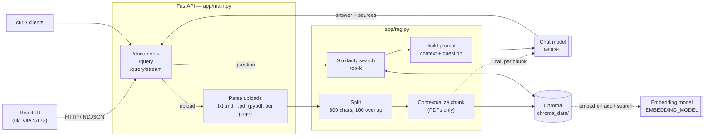

# RAG Engine

FastAPI + Chroma + LangChain. Any chat/embedding model via `MODEL` / `EMBEDDING_MODEL` env vars.

## Architecture



**Ingest:** file → text (one entry per PDF page) → chunks → (PDF) LLM-written context prepended → embedded into Chroma.
**Query:** question → top-k chunks from Chroma → prompt with `[source]` tags → LLM → answer (streamed as NDJSON on `/query/stream`).

## Setup

```sh
python -m venv .venv
.venv\Scripts\activate          # Windows  (source .venv/bin/activate elsewhere)
pip install -r requirements.txt
cp .env.example .env

# default models are local, via Ollama (https://ollama.com)
ollama pull llama3.2
ollama pull nomic-embed-text
```

## Run

```sh
uvicorn app.main:app --reload
```

Interactive docs: http://localhost:8000/docs

```sh
curl -F "files=@notes.md" -F "files=@manual.pdf" localhost:8000/documents   # .txt, .md, .pdf
curl -X POST localhost:8000/query -H "Content-Type: application/json" -d '{"question": "What is in my notes?"}'
curl -X DELETE localhost:8000/documents
```

## UI

React (Vite) app in `ui/`. Run the API first, then:

```sh
cd ui
npm install
npm run dev     # http://localhost:5173, proxies API calls to :8000
```

## Context-enriched chunking (PDFs)

Each PDF chunk is sent to `MODEL` together with the whole document, and the model writes a 1–2 sentence
context (e.g. "From section 3 on pricing, about refunds"). That context is prepended to the chunk before
embedding, so chunks like "it costs $5" stay findable. This costs one LLM call per chunk at upload time.
The document is truncated to `MAX_DOC_CHARS` in `app/rag.py`.

## Switching models

Set `MODEL` / `EMBEDDING_MODEL` in `.env` as `provider:model` and install the provider package:

| Provider  | Package               | Example                                   |
|-----------|-----------------------|-------------------------------------------|
| Ollama    | `langchain-ollama`    | `ollama:llama3.2`                         |
| Anthropic | `langchain-anthropic` | `anthropic:claude-sonnet-5-5`             |
| OpenAI    | `langchain-openai`    | `openai:gpt-4.1`, `openai:text-embedding-3-small` |

Changing `EMBEDDING_MODEL` after ingesting? `DELETE /documents` and re-upload. Vectors from different models don't mix.

## Test

```sh
python test_rag.py
```
